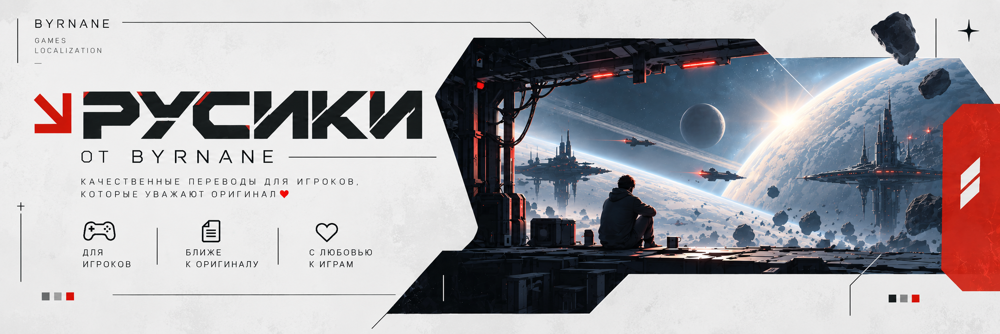

<picture>
  <source media="(prefers-color-scheme: dark)" srcset="banner_dark.png">
  <source media="(prefers-color-scheme: light)" srcset="banner.png">
  
</picture>

# Русификаторы от Byrnane

Мои неофициальные переводы игр на русский язык.

Готовые русификаторы и инструкции находятся в [каталоге на сайте автора](https://rusiki.byrnane.dev/).

Каждая игра обновляется отдельно. На ее странице можно скачать установщик EXE или ZIP-архив. Ссылки скачивания всегда ведут на актуальную версию. Дополнительные зеркала указаны там же.

## Игры

### STAR WARS: Galactic Racer

[Описание, скриншоты и инструкция](https://rusiki.byrnane.dev/galactic-racer-ru/)

- **Версия 1.0** · [Установщик EXE](https://github.com/byrnane/rusiki/releases/download/galactic-racer-ru-v1.0/Galactic-Racer-RUS-Byrnane-v1.0-Setup.exe) · [ZIP-архив](https://github.com/byrnane/rusiki/releases/download/galactic-racer-ru-v1.0/Galactic-Racer-RUS-Byrnane-v1.0.zip) · [Что нового](https://github.com/byrnane/rusiki/releases/tag/galactic-racer-ru-v1.0)
- [Предыдущая версия 0.6.0](https://github.com/byrnane/rusiki/releases/tag/galactic-racer-ru-v0.6.0)

Если заметили ошибку в переводе или возникла проблема с установкой, [сообщите о ней](https://github.com/byrnane/rusiki/issues). Укажите игру и версию русификатора.
